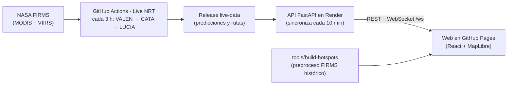

# CATACLISMO

Plataforma de mando para incendios forestales en España: une las detecciones de fuego de los
satélites de la NASA, una predicción de propagación con redes neuronales, las vías de evacuación y
el seguimiento de los equipos en terreno en un solo mapa. Propuesta del equipo CATACLISMO para
**NASA Space Apps 2026**.

**Web publicada:** https://cataclismoteam.github.io/CATACLISMO/

> [!IMPORTANT]
> **Usa la web en Google Chrome** (o Chromium), versión actual y de escritorio. Es el navegador con
> el que se prueba todo (e2e y Lighthouse) y el que mejor maneja el mapa 3D (WebGL). Otros
> navegadores, como Brave, Firefox o Safari, pueden bloquear la conexión con el backend o el
> mapa: si el chip «API» de la barra sale tachado, ábrela en Chrome.

Para equipos de emergencias, gestores del territorio y personal científico.

## Qué hace

- **Mapa de mando** 2D y 3D (relieve real), con satélite o topográfico y curvas de nivel.
- **Incendios reales** de NASA FIRMS de los últimos 90 días, por comunidad autónoma, en celdas de
  250 m: rojo si siguen activos al cierre del dato y gris ceniza si ya no.
- **Predicción en vivo** (backend): cada 3 horas, la red neuronal CATA predice hacia dónde avanza
  el fuego detectado hoy y LUCIA calcula las vías de escape para personas y animales.
- **Equipos en terreno** (JULI): posición y estado en vivo por WebSocket, con aviso si alguien no
  da prueba de vida.
- **12 escenarios simulados** con línea de tiempo del fuego (0 a 6 h), unidades por tierra y aire,
  radio, avisos de núcleos en riesgo y vías de escape por carretera.
- **Histórico** mes a mes desde 2012 sobre cualquier área: cuánto ha ardido y si el mes se sale de
  lo normal; se pinta en el mapa y se exporta a CSV y PNG.
- **Herramientas**: buscar lugares o coordenadas, medir distancias y áreas, compartir la vista con
  un enlace, español e inglés, tema claro u oscuro y modo para daltonismo.

## Qué es real, qué es predicción y qué es simulado

La interfaz lo rotula siempre (chip de procedencia en la barra superior).

| Capa                                   | Origen                                          | Actualización              |
| -------------------------------------- | ----------------------------------------------- | -------------------------- |
| Incendios detectados e histórico       | **Real**: NASA FIRMS (MODIS 1 km y VIIRS 375 m) | Preproceso del dato (fijo) |
| CATA · predicción neuronal             | **Predicción** sobre FIRMS de hoy (celdas 1 km) | Cada 3 h (GitHub Actions)  |
| LUCIA · vías de escape                 | **Predicción** a partir de CATA                 | Cada 3 h, con CATA         |
| JULI · equipos en terreno              | **Backend** (equipos de demostración)           | En vivo (WebSocket)        |
| Escenarios, unidades y rutas simuladas | **Simulado**: modelo elíptico de demostración   | Fijo                       |
| Halo de avance de los incendios reales | **Ilustrativo** (viento de ejemplo, apagado)    | Fijo                       |

## Arquitectura



- **Web** (`frontend/`): estática en GitHub Pages. Se conecta sola a la API (`VITE_API_URL` del
  build); si la API no responde, sigue con sus datos estáticos.
- **API** (`backend/`): en Render (`render.yaml`), sin TensorFlow. Sirve CATA, LUCIA y JULI y
  descarga los resultados del ciclo en vivo (`backend/app/live_sync.py`).
- **Ciclo en vivo** (`.github/workflows/live-nrt.yml`): corre en GitHub Actions porque CATA
  necesita TensorFlow, que no cabe en el servidor gratuito.
- **Preproceso** (`tools/build-hotspots/`): armoniza 2012–2026 de FIRMS y genera los datos
  estáticos de la web (rejilla histórica, incendios y vías de escape de los escenarios).

## Backend en cuatro piezas

Detalle completo en [backend/README.md](backend/README.md).

- **VALEN**: valida y enriquece las detecciones (meteorología, lluvia, vegetación, relieve y
  carreteras) en una cuadrícula de 1 km (`EPSG:3035`, `ES1K`).
- **CATA**: red neuronal ConvLSTM (22 canales) que predice el estado del fuego a 6 horas.
- **LUCIA**: red neuronal + A\* que calcula rutas de evacuación seguras y puntos de encuentro.
- **JULI**: mando y control de equipos en terreno: posición, prueba de vida, radio y chat cifrado.

## Stack

| Parte      | Tecnología                                                      |
| ---------- | --------------------------------------------------------------- |
| Interfaz   | React + TypeScript (Vite), Tailwind, Zustand                    |
| Mapa       | MapLibre GL + MapTiler (relieve, satélite y geocodificación)    |
| Gráficos   | ECharts                                                         |
| Backend    | Python + FastAPI (uv), WebSocket `/ws`                          |
| Modelos    | TensorFlow / Keras (CATA y LUCIA)                               |
| Datos      | PostgreSQL + PostGIS (en local), GeoJSON y binarios propios     |
| Despliegue | GitHub Pages (web), Render (API), GitHub Actions (CI y en vivo) |

## Estructura

```
frontend/   web React + TS + MapLibre (Vite); el build sale a dist/ en la raíz
backend/    API FastAPI: app/main.py, app/{valen,cata,lucia,juli}, app/live_nrt.py y app/live_sync.py
tests/      e2e, regresión visual e integración con Playwright sobre el build real
tools/      build-hotspots (preproceso FIRMS) y dev-utils (guardián, enlaces, peso, commits)
config/     application/: Playwright, Lighthouse, html-validate, Prettier y release-please
ops/        docker/ (imagen de la API) y deployment/ (página de mantenimiento)
docs/       seguimiento, hoja de ruta, evaluación heurística y traspaso
render.yaml despliegue de la API en Render
```

## Puesta en marcha

Requisitos: Node 26, pnpm 12 (nunca npm ni yarn), uv y, opcionalmente, Docker.

```bash
pnpm install   # dependencias y hooks de git
pnpm dev       # web en http://localhost:5173/CATACLISMO/
```

API en local y la web conectada a ella:

```bash
cd backend && uv sync && uv run uvicorn app.main:app --reload --port 8000
# abre http://localhost:5173/CATACLISMO/?api=http://localhost:8000
```

En local la web no usa el backend de producción: hay que pedirlo con `?api=` (vale para esa
pestaña). Con Docker, `cp .env.example .env` y `docker compose up` levantan PostGIS y la API.

## Datos en vivo y `FIRMS_MAP_KEY`

- La clave de NASA FIRMS está en los **secretos del repositorio** (`FIRMS_MAP_KEY`) y nunca se
  versiona. La usa el workflow **Live NRT**, que publica los resultados en la release `live-data`.
- La API de Render los descarga sola (`LIVE_DATA_URL`, activa por defecto cuando corre en Render)
  y avisa a la web con el evento `live_nrt_updated`.
- Ciclo completo en local (necesita la clave en `backend/.env` y Python 3.13, que es la versión con
  TensorFlow):

  ```bash
  cd backend
  uv sync --python 3.13 --extra trainer
  mkdir -p app/cata/artifacts/models && cp checkpoints/best_model.keras app/cata/artifacts/models/cata_c22.keras
  uv run python -m app.live_nrt --days 2
  ```

- Sin clave, FIRMS rechaza la petición. NASA POWER y Open-Meteo no necesitan clave.

## Despliegue

- **Web**: cada push a `main` pasa por [`deploy.yml`](.github/workflows/deploy.yml): 10 módulos
  en paralelo (guardián, calidad, workflows, secretos, dependencias, CodeQL, build, Lighthouse, e2e
  y backend). Solo si pasan todos se publica en GitHub Pages, con prueba de humo. La URL de la API
  va en la variable del repo `VITE_API_URL`. Modo mantenimiento: _Run workflow → maintenance_ o la
  variable `MAINTENANCE_MODE=true`.
- **API**: Render la redespliega en cada push a `main` que toque `backend/` (`render.yaml`).
- **Ciclo en vivo**: workflow **Live NRT** cada 3 horas (o a mano desde Actions).
- Los commits siguen [Conventional Commits](https://www.conventionalcommits.org/es/);
  release-please genera las versiones y el CHANGELOG.

## Comprobaciones locales

```bash
pnpm format:check && pnpm check && pnpm lint && pnpm test
pnpm build && pnpm check:links && pnpm check:html && pnpm check:size && pnpm check:guard
CHROME_PATH=/usr/bin/chromium pnpm test:e2e
cd backend && uv run ruff check . && uv run pytest -m "not trainer"
cd tools/build-hotspots && uv run pytest
```

## Limitaciones conocidas

- Los escenarios simulados usan un modelo elíptico de demostración: no tiene en cuenta
  combustible, humedad ni pendiente. No es una herramienta operativa.
- La API está en el plan gratuito de Render: tras 15 min sin uso se duerme y la primera visita
  tarda hasta un minuto en conectar (la web lo indica y funciona igual con sus datos).
- En Render no hay base de datos PostGIS (`/health` lo indica); nada de lo que muestra el mapa la
  necesita hoy.
- El área de FIRMS del ciclo en vivo (35–44° N, 10° O–4,5° E) incluye el norte de Marruecos y
  Argelia, así que alguna zona predicha puede caer fuera de España.
- El histórico de la web se genera con el preproceso y no se actualiza solo.

## Fuentes y créditos

- [NASA FIRMS](https://firms.modaps.eosdis.nasa.gov/): detecciones de fuego activo
  ([MODIS](https://modis.gsfc.nasa.gov/) y [VIIRS](https://www.earthdata.nasa.gov/sensors/viirs)).
- [NASA POWER](https://power.larc.nasa.gov/): lluvia histórica.
- [Open-Meteo](https://open-meteo.com/): meteorología actual.
- [ESA WorldCover](https://esa-worldcover.org/): vegetación.
- [OpenStreetMap](https://www.openstreetmap.org/copyright): carreteras y núcleos de población.
- [MapTiler](https://www.maptiler.com/copyright/): mapas base, relieve y geocodificación.

## Documentación

- [docs/SEGUIMIENTO.md](docs/SEGUIMIENTO.md): estado del proyecto.
- [docs/MEJORAS.md](docs/MEJORAS.md): hoja de ruta y pendientes.
- [docs/evaluacion-heuristica.md](docs/evaluacion-heuristica.md): evaluación de usabilidad.
- [frontend/README.md](frontend/README.md), [backend/README.md](backend/README.md) y
  [tools/build-hotspots/README.md](tools/build-hotspots/README.md).

## Equipo

Equipo CATACLISMO · NASA Space Apps Challenge 2026.

## Licencia

[MIT](LICENSE).
