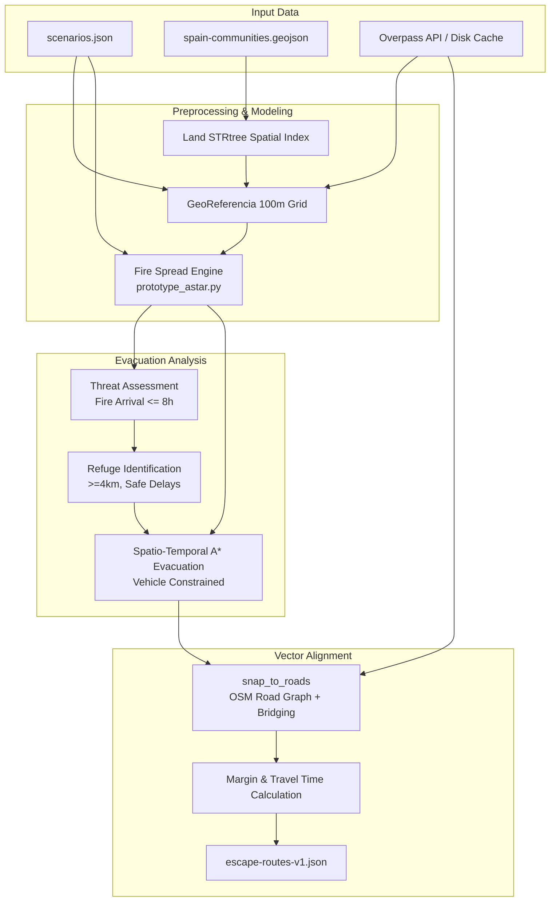

# Technical Architecture & Engineering Reference

## 1. System Overview & Architecture

The wildfire escape route generation pipeline (`tools/build-hotspots/build_hotspots/escape.py`) is an offline preprocessing subsystem designed to calculate spatio-temporal evacuation routes for active wildfire simulation scenarios.

The pipeline combines geographic boundary vector data, real-time OpenStreetMap (OSM) highway and settlement data, and dynamic wildfire propagation modeling to determine safe evacuation paths from threatened population centers to secure refuges.

### Core Processing Flow
1. **Scenario Ingestion & Spatial Querying**: For each wildfire scenario, a spatial bounding box (`~15 km` extent centered at the ignition focus) is queried against the Overpass API to fetch road geometries and settlement nodes.
2. **Terrain & Maritime Classification**: Regional boundary polygons (loaded into a Shapely `STRtree` spatial index) determine land vs. water boundaries across a discrete 100-meter resolution grid.
3. **Dynamic Wildfire Spread Modeling**: A team simulation engine (`backend/app/lucia/prototype_astar.py`) propagates the fire perimeter across the grid based on scenario-defined wind speed and direction, calculating ignition timestamps for all cells.
4. **Threat Assessment & Refuge Allocation**: Settlements reaching fire contact within 8 hours are identified as threatened. Refuges are filtered based on distance, arrival delay of fire, population place type, and road-network reachability.
5. **Vehicle-Constrained Spatio-Temporal Search**: Evacuation routes are computed via spatio-temporal A* routing constrained primarily to vehicle-accessible roads (`=`, `R`, `-`).
6. **Network Snapping & Simplification**: Grid-based path sequences are projected onto actual OSM vector road geometries via corridor-bounded shortest path routing (`snap_to_roads`), bridge-gap repair heuristics, and line simplification.



---

## 2. Core Modules & Components

### `tools/build-hotspots/build_hotspots/escape.py`
The primary module orchestrating extraction, grid rasterization, algorithmic simulation, path refinement, and serialization.

- **Dynamic Algorithm Loader**: Dynamically imports the external prototype module `backend/app/lucia/prototype_astar.py` using `importlib.util`.
- **Overpass API Client**: Fetches road polylines (`highway`) and population nodes (`place`) with multi-endpoint fallback, local caching, and custom User-Agent headers.
- **Land Boundary Indexer (`Land`)**: Renders polygon containment checks fast using Shapely's spatial predicate index (`STRtree`).
- **Topological Snapping Engine**: Converts discrete raster paths back to high-fidelity vector lines on the OSM road network while bridging gaps caused by non-intersecting road segments in raw OSM data.

---

## 3. API, Functions & Interfaces Reference

### CLI Interface

```bash
build-escape-routes --scenarios <PATH_TO_SCENARIOS_JSON> --out <PATH_TO_OUTPUT_DIR> [--regions <PATH_TO_REGIONS_DIR>] [--cache <PATH_TO_CACHE_DIR>]
```

#### CLI Arguments
- `--scenarios` (`Path`, required): Path to the wildfire scenario input JSON (e.g., `frontend/src/map/scenarios.json`).
- `--out` (`Path`, required): Output directory where `escape-routes-v1.json` will be generated.
- `--regions` (`Path`, optional): Directory containing `spain-communities.geojson` (default: `ROOT/data/raw/limites`).
- `--cache` (`Path`, optional): Directory to store raw OSM responses (default: `ROOT/data/raw/osm`).

---

### Key Classes

#### `Land`
Encapsulates territory boundaries to distinguish dry land from sea.

- **`__init__(path: Path) -> None`**
  - Loads GeoJSON features from disk.
  - Instantiates `shapely.geometry.shape` instances and creates an `STRtree`.
- **`is_land(lon: float, lat: float) -> bool`**
  - Evaluates whether the given longitude and latitude intersect with any land polygon using `tree.query(points(lon, lat), predicate="intersects")`.

---

### Core Pipeline Functions

#### `load_team_module() -> module`
- Dynamically locates and loads `backend/app/lucia/prototype_astar.py` into `sys.modules["cataclismo_escape"]`.
- Returns the loaded Python module containing classes such as `GeoReferencia` and functions like `calcular_tiempos_fuego`, `encontrar_via_escape`, `calcular_metricas_evacuacion`, and `ruta_a_geojson`.

#### `overpass(bbox: tuple[float, float, float, float], cache: Path) -> dict`
- **Parameters:**
  - `bbox`: Bounding box tuple `(min_lon, min_lat, max_lon, max_lat)`.
  - `cache`: Local filesystem path to cache JSON responses.
- **Behavior:** Queries OSM Overpass API for `way["highway"~...]` and `node["place"~...]`. Tries endpoints in `OVERPASS` with exponential backoff if HTTP/network errors occur. Reads from `cache` if already cached.
- **Returns:** Parsed JSON dictionary of OSM elements.

#### `snap_to_roads(coords: list[tuple[float, float]], osm: dict, corridors_m: tuple[float, ...] = SNAP_CORRIDORS_M) -> list[tuple[float, float]]`
- **Parameters:**
  - `coords`: List of `(lon, lat)` tuples forming the raw grid path.
  - `osm`: OSM element tree containing highway ways.
  - `corridors_m`: Distance thresholds `(150.0, 300.0, 600.0, 1200.0, 2500.0)` for corridor-restricted path searching.
- **Behavior:**
  1. Maps coordinates to a local Cartesian metric projection (`_metric`).
  2. Constructs an adjacency graph from OSM ways matching `ROAD_CHAR`.
  3. Connects disconnected road components within 150 m (`_bridge_components`) and bridges isolated graph islands within 600 m (`_bridge_gaps`).
  4. Runs Dijkstra pathfinding bounded inside spatial buffer corridors around the guide line.
  5. Simplifies the result using the Ramer-Douglas-Peucker algorithm (`LineString.simplify(4.0)`).
- **Returns:** Vector-snapped list of `(lon, lat)` coordinates.

#### `routes_for(scenario: dict, team: module, land: Land, cache_dir: Path) -> dict`
- **Parameters:**
  - `scenario`: Wildfire scenario configuration containing `id`, `ignition` `[lon, lat]`, `windFrom`, and `windKmh`.
  - `team`: Dynamically loaded `prototype_astar` module.
  - `land`: Initialized `Land` spatial query object.
  - `cache_dir`: Path to OSM cache directory.
- **Returns:** Dictionary containing calculated escape routes and settlement metadata:
  ```json
  {
    "rutas": [
      {
        "nombre": "Origin → Destination",
        "desde": "Origin Node Name",
        "refugio": "Destination Refuge Name",
        "coords": [[lon, lat], ...],
        "distanciaKm": 12.4,
        "tiempoMin": 37,
        "margenMin": 45,
        "llegadaFuegoMin": 120
      }
    ],
    "nucleos": 15
  }
  ```

---

### Internal Math & Graph Helpers

- **`_km(lon1: float, lat1: float, lon2: float, lat2: float) -> float`**: Equirectangular projection approximation for distance between geographical coordinates.
- **`_metric(lat0: float) -> tuple[Callable[[float, float], tuple[float, float]], float]`**: Computes local planar projection scaling factors (meters per degree).
- **`_line_cells(geo, coords: list[tuple[float, float]], rows: int, cols: int)`**: Samples raster grid indices intersected by a vector polyline.
- **`_road_components(grid: list[list[str]]) -> dict[tuple[int, int], int]`**: Labels 8-connected components across road grid cells (`=`, `R`, `-`).
- **`_components(adjacency: dict) -> dict`**: Standard graph connected components implementation.
- **`_bridge_components(adjacency: dict, metric: dict) -> None`**: Adds bidirectional edges between disconnected components within `BRIDGE_M` (150 m) with `BRIDGE_PENALTY` (cost multiplier 2.0).
- **`_bridge_gaps(adjacency: dict, metric: dict) -> None`**: Finds the single shortest bridge between isolated components up to `GAP_M` (600 m).

---

## 4. Configuration, Dependencies & Setup

### Algorithmic & Physical Constants

| Constant | Value | Description |
| :--- | :--- | :--- |
| `CELL_M` | `100.0` | Grid cell size in meters. |
| `HALF_DEG` | `0.07` | Half-bounding-box in degrees (~15 km extent). |
| `MIN_PER_TURN` | `12.0` | Simulation turn duration in minutes (fire advances ~0.4 km/turn). |
| `VEHICLE_CELLS_PER_TURN` | `40.0` | Evacuation speed: 40 cells / turn (~4 km in 12 min = 20 km/h). |
| `VEHICLE_KMH` | `20.0` | Equivalent evacuation speed in km/h. |
| `SIMPLIFY_M` | `4.0` | Douglas-Peucker simplification tolerance in meters. |
| `BRIDGE_M` | `150.0` | Maximum distance to link disjoint intersecting OSM ways. |
| `BRIDGE_PENALTY` | `2.0` | Cost multiplier applied to synthetic bridge links. |
| `GAP_M` | `600.0` | Maximum gap distance for linking isolated road components. |
| `MAX_SNAP_DETOUR` | `1.6` | Maximum ratio of snapped path length to original grid path length. |

### Road Character Mapping (`ROAD_CHAR`)

| OSM Highway Tag | Grid Symbol | Classification |
| :--- | :--- | :--- |
| `motorway`, `trunk`, `primary`, `secondary` | `=` | Primary arterial roads |
| `tertiary`, `unclassified`, `residential` | `R` | Secondary and residential roads |
| `track` | `-` | Unpaved tracks and trails |

### External Dependencies
- **Python**: 3.10+
- **`shapely`**: Required for `STRtree`, `points`, `LineString`, and `shape`.
- **`urllib` / Standard Library**: Used for Overpass API requests and JSON handling.
- **Local Module**: `backend/app/lucia/prototype_astar.py` must be present relative to the project root.

### Execution Command

```bash
python -m tools.build-hotspots.build_hotspots.escape \
  --scenarios frontend/src/map/scenarios.json \
  --out frontend/public/data \
  --regions data/raw/limites \
  --cache data/raw/osm
