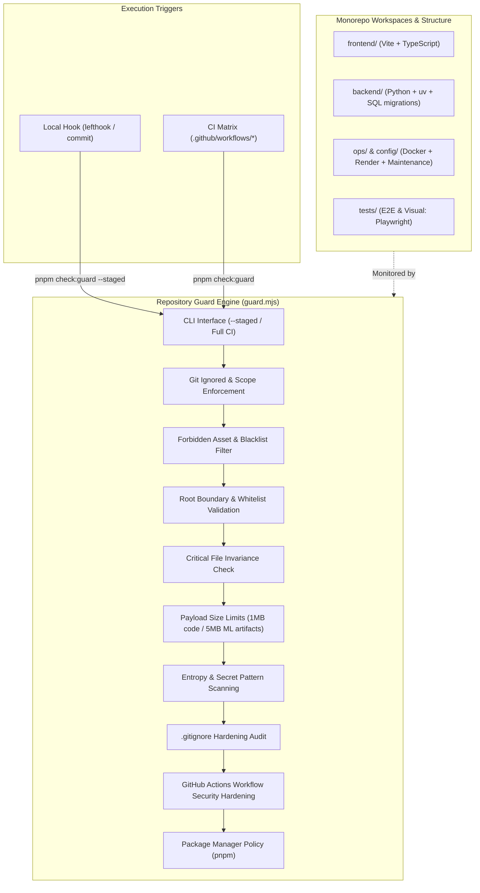

# Technical Architecture & Engineering Reference

## 1. System Overview & Architecture

Equipo CATACLISMO is structured as a polyglot monorepo featuring a TypeScript/Vite frontend, a Python-based backend managed via `uv`, an operations and deployment layer targeting Render and Docker, and an automated verification and security toolchain.

The repository enforces strict architectural boundaries, repository integrity, and supply chain security at both pre-commit and CI/CD stages. The repository guard (`tools/dev-utils/guard.mjs`) acts as a gatekeeper across the repository lifecycle, verifying workspace boundaries, static file limits, secret detection patterns, GitHub Actions workflow hardening, and package manager governance.

### Architectural Layout & Security Pipeline



---

## 2. Core Modules & Components

### 2.1 Developer Tooling & Verification (`tools/dev-utils/`)

#### `tools/dev-utils/guard.mjs`
Zero-dependency Node.js verification engine executing Git commands and native filesystem assertions to enforce repository invariant properties:
- **Scope Detection:** Differentiates between index staging mode (`--staged` via `git diff --cached`) for pre-commit hooks and full tree inspection (`git ls-files`) for CI environments.
- **Leakage Prevention:** Rejects committed files that match active `.gitignore` rules or forbidden path patterns.
- **Root Layout Enforcement:** Restricts root directory entries to an explicitly allowed whitelist.
- **Critical Asset Verification:** Guarantees critical configuration, CI, frontend, backend, test, and ops files cannot be deleted accidentally.
- **Binary & Model Thresholds:** Caps file sizes at 1024 KB by default, providing an exception ceiling (5120 KB) exclusively for model checkpoints and backend artifacts (`backend/checkpoints/`, `backend/app/*/artifacts/`).
- **High-Entropy Secret Scanning:** Scans file content for private keys, AWS access keys, GitHub tokens, OpenAI/Anthropic API keys, Slack tokens, and Google API tokens.
- **CI Workflow Hardening:** Audits `.github/workflows/*.yml` files for minimum permissions (`permissions: {}`), rejects insecure fork execution triggers (`pull_request_target`), enforces 40-character SHA pinning for third-party actions, and verifies `persist-credentials: false` on checkouts.
- **Package Manager Invariance:** Enforces that `package.json` specifies `pnpm` as the designated package manager.

### 2.2 Licensing

#### `LICENSE`
- Distributed under the MIT License, Copyright (c) 2026 Equipo CATACLISMO.

---

## 3. API, Functions & Interfaces Reference

### Repository Guard Engine (`tools/dev-utils/guard.mjs`)

Executed via Node.js runtime without external npm dependencies:

```bash
# Full repository validation (CI environment)
node tools/dev-utils/guard.mjs
# Local check alias
pnpm check:guard

# Staged files only (Pre-commit Git hook)
node tools/dev-utils/guard.mjs --staged
```

#### Internal Functions and Data Structures

| Identifier | Type | Description |
| :--- | :--- | :--- |
| `fail(msg)` | `(msg: string) => void` | Appends error string to `errors` array. Triggers `process.exit(1)` upon completion if any errors exist. |
| `git(...args)` | `(...args: string[]) => string[]` | Synchronously executes `git` CLI commands via `child_process.execFileSync`, returning non-empty trimmed lines. |
| `tracked` | `string[]` | Set union of `git ls-files` (tracked) and `git ls-files --others --exclude-standard` (unignored untracked). |
| `staged` | `boolean` | Flag set to `true` if `process.argv` includes `--staged`. |
| `scope` | `string[]` | Active validation target list: staged files (`--diff-filter=ACMR`) when `staged === true`, otherwise all `tracked` files. |
| `inScope` | `Set<string>` | Constant-time lookup set of files within `scope`. |

#### Rule Sets and Pattern Constraints

- **Forbidden Files (`forbidden`):**
  - Environment files matching `(^|\/)\.env(\.(?!example$)[^/]+)?$`
  - Keypairs and certificates: `\.(pem|key|crt|cer|p12|pfx|jks|keystore|gpg|asc|ppk)$`
  - SSH identity files: `(^|\/)id_(rsa|ed25519|ecdsa|dsa)(\.pub)?$`
  - Credential files: `\.npmrc`, `\.netrc`, `\.htpasswd`, `\.pypirc`
  - Service credentials: `(credentials|secrets?|service-account)[^/]*\.json$`
  - SQL files outside migration path: rejects any `.sql` not beginning with `backend/sql/`
  - Databases/backups: `\.(sqlite3?|db|dump|bak|backup)$`
  - Ephemeral build artifacts: `node_modules/`, `dist/`, `.vite/`, `.lighthouseci/`, `coverage/`, `playwright-report/`, `test-results/`
  - Python virtual environments and caches: `.venv/`, `venv/`, `__pycache__/`, `.pytest_cache/`, `.ruff_cache/`
  - Extraneous package manager locks: `package-lock.json`, `yarn.lock`, `bun.lock`, `bun.lockb`
  - Editor/Agent state: `.claude/`, `.codex/`, `.cursor/`, `.idea/`
  - Log dumps: `\.log$`

- **Allowed Root Structure (`allowedRoot`):**
  - Directories: `.github`, `backend`, `config`, `data`, `docs`, `frontend`, `ops`, `packages`, `scripts`, `tests`, `tools`
  - Files: `.dockerignore`, `.env.example`, `.gitignore`, `CHANGELOG.md`, `LICENSE`, `README.md`, `docker-compose.yml`, `lefthook.yml`, `package.json`, `pnpm-lock.yaml`, `pnpm-workspace.yaml`, `render.yaml`

- **Required Repository Files (`required`):**
  - Configurations: `.gitignore`, `.dockerignore`, `package.json`, `pnpm-lock.yaml`, `pnpm-workspace.yaml`, `render.yaml`, `lefthook.yml`
  - Frontend: `frontend/package.json`, `frontend/vite.config.ts`, `frontend/public/404.html`
  - Backend: `backend/pyproject.toml`, `backend/uv.lock`
  - Workflows & Policies: `.github/workflows/deploy.yml`, `.github/workflows/release.yml`, `.github/workflows/scorecard.yml`, `.github/workflows/links.yml`, `.github/workflows/monitor.yml`, `.github/PULL_REQUEST_TEMPLATE/pull_request_template.md`, `.github/dependabot.yml`, `.github/SECURITY.md`
  - Ops: `ops/deployment/maintenance.html`
  - Dev Utilities: `tools/dev-utils/guard.mjs`, `tools/dev-utils/commit-msg.mjs`, `tools/dev-utils/check-links.mjs`, `tools/dev-utils/check-size.mjs`, `tools/dev-utils/serve.mjs`
  - Playwright Tests: `tests/e2e/portada.spec.ts`, `tests/visual/portada.spec.ts`

- **Size Constraints:**
  - Standard maximum: `MAX_KB = 1024` (1 MB).
  - Machine learning checkpoint maximum: `MODEL_KB = 5120` (5 MB), matching path pattern `/^backend\/(checkpoints\/|app\/[^/]+\/artifacts\/)/`.

- **Secret Patterns (`secretPatterns`):**
  - Private Keys: `-----BEGIN [A-Z ]*PRIVATE KEY-----`
  - GitHub Tokens: `\bgh[pousr]_[A-Za-z0-9]{36,}\b`, `\bgithub_pat_[A-Za-z0-9_]{60,}\b`
  - AWS Access Keys: `\bAKIA[0-9A-Z]{16}\b`
  - OpenAI / Anthropic Keys: `\bsk-(ant-|proj-)?[A-Za-z0-9_-]{32,}\b`
  - Slack Tokens: `\bxox[baprs]-[A-Za-z0-9-]{10,}\b`
  - Google API Keys: `\bAIza[0-9A-Za-z_-]{35}\b`
  - Exempted text files: `pnpm-lock.yaml`, `backend/uv.lock`.

- **Workflow Hardening Rules (`.github/workflows/*.yml`):**
  - Top-level `permissions: {}` declaration required.
  - Ban on `pull_request_target` event triggers.
  - Third-party Actions must be pinned to 40-character commit SHAs (`uses: owner/repo@<commit-sha>`), exempting local paths (`./`) and Docker container actions (`docker://`).
  - Strict checkout hygiene: all occurrences of `actions/checkout@...` must specify `persist-credentials: false`.

---

## 4. Configuration, Dependencies & Setup

### Environment & Toolchain Prerequisites
- **Node.js:** Standard Node runtime (uses built-in `node:child_process` and `node:fs` modules).
- **Git:** CLI must be accessible in system `$PATH` for git index interrogation.
- **Package Manager:** `pnpm` (enforced via `package.json` property `packageManager: pnpm@...`).
- **Python Packaging:** `uv` managing `backend/pyproject.toml` and `backend/uv.lock`.

### Repository Commands
- Run Repository Guard:
  ```bash
  pnpm check:guard
  ```
- Run Pre-commit Guard (Staged Scope):
  ```bash
  node tools/dev-utils/guard.mjs --staged
  ```
